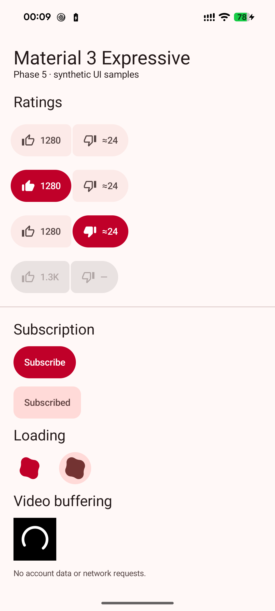
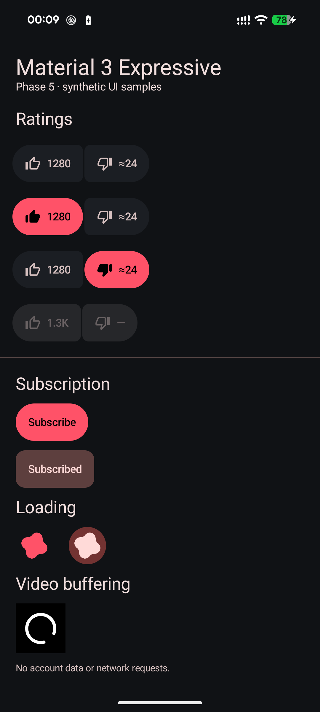

# UI refresh — Phase 5

## Implementation

Source paths below are relative to `app/src/main/java/dev/quietube/`.

1. **Dependencies:** `app/build.gradle.kts` pins Compose BOM `2026.09.00` and Material 3 `1.5.0-rc01`; version is now 0.5.8 (19). The owner explicitly approved the release candidate because the latest stable Material 3, 1.4.0, does not expose the required Expressive components. Activity, Navigation and Lifecycle did not require upgrades. No analytics, logging, Play Services, Firebase or third-party network integration was added. Expressive loading opt-ins are file-local.
2. **Theme and motion:** `ui/Theme.kt:136` uses MaterialExpressiveTheme with MotionScheme.expressive(), retaining the complete brand/wallpaper schemes, typography, shapes and appearance preferences. ScreenMotion and its back-preview timings are unchanged.
3. **Connected ratings:** `ui/EngagementButtons.kt:27` uses ButtonGroup with connected ToggleButton shapes, icons and counts, filled checked states and adaptive overflow. Like/Remove like and Dislike/Remove dislike accessibility labels remain. Signed-out controls remain disabled; “Sign in to rate” appears as a transient snackbar only after an attempted tap. Targets have a 48dp minimum height.
4. **Subscription:** `ui/EngagementButtons.kt` uses primary filled styling for Subscribe and tonal styling for Subscribed. ToggleButton supplies the shape morph; animateColorAsState uses the Expressive fast-effects spec for the colour morph. Pending requests disable repeat taps. `MainActivity.kt:109` collects one Confirm haptic event per accepted mutation, including Retry and Undo, rather than firing on recomposition, refresh or rollback.
5. **Loading:** `ui/AppLoadingIndicator.kt:10` replaces indeterminate circular spinners in the mini player, feed/search load-more and cast discovery. Per review feedback, the video buffering overlay uses a monochrome circular spinner. `ui/RefreshBox.kt:11` supplies PullToRefreshDefaults.LoadingIndicator for feeds and comments. `ui/VideoCardPlaceholder.kt:39` shares a live animation-setting observer; disabled animations use static Expressive shapes with indeterminate loading semantics. Existing linear progress displays remain.
6. **Optimistic actions:** `account/actions/EngagementViewModel.kt:88` updates rating/subscription state before launching the request, serializes actions, restores the previous metadata on failure and offers Retry. Successful unsubscribe offers Undo. The ViewModel remains the only action-state owner; snackbar actions carry notice IDs and cannot cross a video/account change. Session revisions also block taps before the session collector resets the old UI. Numeric like counts update locally; formatted/unknown counts and third-party dislike estimates are preserved.
7. **API migration:** list items, community tabs, bottom-sheet state and search use the current non-deprecated APIs. `ui/SearchScreen.kt:25` uses TextFieldState, SearchBarState and ExpandedFullScreenSearchBar while retaining the search route, history, results, paging and error states. Typing flows from the field to the ViewModel; programmatic searches update the field directly. This avoids a feedback loop that dropped characters. The collapsed bar applies the status-bar inset explicitly.
8. **Review samples:** `app/src/samples/` renders the production controls using synthetic state in a separate `dev.quietube.samples` installation. The sample activity reads no account and makes no network calls. It is excluded from debug/release. The normal app's sign-in data was retained.

## Validation

```sh
./gradlew assembleDebug assembleRelease assembleSamples testDebugUnitTest lintDebug
```

Final combined build succeeded in 1m 43s (155 tasks: 46 executed, 109 up-to-date). All 154 offline JVM tests pass, zero failures/errors. Lint has zero errors, the same 41 existing warnings, and no new findings against the pre-phase XML report. Compilation has no deprecation warnings. `git diff --check` passes.

The 13 new tests cover synchronous optimistic state, accepted results, exact rollback and retry, active-rating removal, like/dislike count handling, unsubscribe/undo, duplicate-tap serialization, sign-out invalidation, non-cancellable stale responses, notice invalidation, account-revision races, and one haptic event per accepted action. No JVM test contacts YouTube.

### Pixel 8

- Installed the optimized 0.5.8 release APK over the existing app without clearing its account/data.
- Used the separate signed-out sample installation for anonymous playback: the test video played, MediaSession reported PLAYING, PiP reported a pinned task, and Back returned to a playing mini player above navigation. Playback was paused and closed afterward.
- Search expanded, retained exact injected text (`blender`, then `quietube`), submitted with Enter and collapsed to results with navigation visible. The final collapsed input bounds began at y=132 rather than under the status bar. Edge-back committed from search to Home. This checks the gesture's committed destination, not frame-by-frame predictive preview quality.
- Inspected native light/dark component samples. The accessibility tree contains checked toggle parents, disabled signed-out controls and loading semantics; the rating targets measured 126px at the device's 2.625 density (48dp).
- Set animator duration scale to zero temporarily. The two loading shapes had zero differing pixels in their region across separate captures. The original setting was restored. Reading the setting directly fixed an initially stale ValueAnimator cache during live setting changes.
- The original animator setting (unset) and plugged-in stay-awake setting (0) were restored. The final release APK cold-started successfully in the normal installation.
- Screenshots below contain synthetic state only. No signed-in account screenshot is included in the repository.

### Screenshot samples

| Light | Dark |
| --- | --- |
|  |  |

The isolated gallery shows unselected/liked/disliked and signed-out ratings, Subscribe/Subscribed, both Expressive loading variants and the monochrome video-buffering spinner. These are native captures of production components with synthetic state, not full signed-in player screens.

## Intermediate failures and corrections

Compiler/API migration diagnostics included these verbatim message excerpts (local filesystem prefixes omitted):

```text
No value passed for parameter 'consume'.
This material3 API is experimental and is likely to change or to be removed in the future.
This annotation is not repeatable.
Attribute application@label value=(YouPoop UI samples)
Unresolved reference 'message'.
```

The snackbar call now names its consume callback, loading opt-ins are file-local, the existing sheet opt-in is combined correctly, and the samples manifest explicitly overrides its label. A transient signature-edit error was corrected before the passing final build. The dependency upgrade did not require changes to playback or navigation architecture.

Device automation also caught dropped search characters and an animated contained loader after a live Remove animations change. The text-state feedback loop and cached animation-setting read were corrected and the checks repeated. Initial capture scripts reported:

```text
ModuleNotFoundError: No module named 'PIL'
AssertionError
```

The unavailable image-analysis package was replaced with native bitmap comparison. An early reduced-motion comparison failed before the observer fix; the final comparison reports zero differing pixels. Early search assertions also ran during an app replacement or before focus was ready; the final sequential checks wait for the expanded field and pass. Scratch logs, XML and scripts remain ignored.

## Scope and remaining acceptance

The release-candidate dependency and monochrome video-buffering spinner are approved departures from the original brief. No Phase 6 work is included. Actual YouTube rating/subscription mutations were not performed; success/failure/retry/undo and haptic event counts were verified with offline fakes. Physical haptic feel, a full TalkBack session, large-font layouts, casting, background/lock-screen playback, tablet/foldable layouts and a full predictive-back regression across all routes remain manual acceptance checks. The PiP/playback smoke test does not substitute for a full regression pass.

No further owner decision is needed to review this phase. The requested PR targets `main`; Phase 6 has not started.

## Review feedback — 0.5.6

- Removed the persistent signed-out rating note. `EngagementButtons.kt` observes attempted taps on the disabled control in the initial pointer pass; rating remains disabled and the snackbar explains sign-in. The explanation is also exposed as an accessibility action. Native checks confirmed no idle note and a hint after the attempted tap. An initial main-pass handler failed because the disabled Material button consumed the event; it was corrected and retested.
- `AccountAvatar.kt` opens Account directly with no submenu; Account retains its Settings action. The shared button has the same behaviour for the avatar and text fallback. Direct Account → Settings navigation was exercised in the separate signed-out installation. The profile avatar in the signed-in release installation also opened Account directly.
- `HistoryReporter.kt` emits no success messages for session creation or progress reports. Error reporting and the reporting intervals/endpoints are retained.
- `PlayerLoadingIndicator.kt` uses a white circular spinner exclusively for the video overlay. Other loaders retain their Expressive shapes. The static fallback respects Remove animations.
- `ScreenMotion.kt` retains hidden outgoing entry IDs until Navigation removes those layers, preventing preview reset from briefly revealing the screen again. Recorded short/fast and longer Settings → Account edge-back gestures were sampled at 100 ms intervals; after Account appeared, the Settings appearance controls did not reappear. The earlier Phase 5 check only verified the committed destination; this adds frame inspection.
- `ThumbnailPrefetcher.kt` and `PrefetchVisibleThumbnails` prepare two offscreen covers ahead and one behind, with no more than three requests. They reuse the same anonymous Coil loader and matching decoded dimensions, cancel outdated requests, run on unmetered Wi-Fi, and stop before sign-out cache cleanup. Search/player route guards also prevent outgoing lists from replacing the current playback-prefetch queue. A separate sample-mode check confirmed a 960 × 540 thumbnail in memory before any image was displayed. This verifies real cache warming, not a percentage improvement in scrolling latency; network-dependent throughput was not benchmarked.

The additional six JVM tests cover look-ahead selection, skeleton/end-of-feed keys, supplied-image fallback, deduplication, cancellation, Wi-Fi gating, request bounds and size changes. The synthetic component screenshots above have been refreshed. No YouTube ratings/subscriptions or sign-out were performed against the owner's session.

## Dark Settings tap flicker investigation

The owner's empty-area tap report was reproduced as a physical display-mode
change on the Pixel 8. A captured 15,000-pixel Settings-header background region
remained exactly `#101215` (zero differing pixels), while device diagnostics
showed 60 → 120 → 60 Hz on touch. A temporary 120 Hz minimum kept the mode stable,
and the owner confirmed the visible flicker stopped. The temporary overrides
were restored after comparison; the owner chose to retain adaptive refresh. Android documents [touch-triggered refresh-rate
boosting](https://developer.android.com/develop/ui/views/animations/adaptive-refresh-rate#general-arr-policy).

No app background/ripple change was needed. Fixed refresh is a phone-wide
workaround with a battery-use tradeoff, separate from the app defaults. At that stage the investigation changed documentation only. The app-scoped
implementation below subsequently added the foreground refresh-rate request.

## App-scoped 120 Hz — 0.5.7

The owner subsequently requested steady 120 Hz inside YouPoop with global adaptive
refresh retained. `ui/SmoothRefreshRate.kt` selects the supported rate at the
current resolution and applies a foreground-window `preferredRefreshRate`.
MainActivity releases the preference on pause/PiP and reapplies it on resume,
configuration changes and focus return. On API 35+, window frame-rate balancing
is disabled only while this request is active and its original value is restored
on release. The implementation uses public APIs, makes no system-settings writes
and runs no artificial animation. Android's display, power and thermal policies
can still override the preference.

Initial DisplayManager samples reported 120 Hz before/during/after taps. These
were later found to be request/cached values rather than proof of physical mode
stability; see the 0.5.8 correction below.
The request was absent from the background/PiP window and restored on PiP
expansion. Anonymous playback and PiP were checked using the separate sample
installation. Five new tests cover mode selection and fallback, including
fractional refresh rates and invalid input. There are now 154 passing offline
JVM tests. This supersedes the earlier diagnosis-only outcome; theme colours and
ripples remain unchanged.

The optimized 0.5.7 release was installed over the signed-in app without clearing
its data. DisplayManager reported 120 Hz in 12 additional idle/tap samples, but that
was not sufficient compositor-level verification;
global minimum refresh remained unset and peak refresh was unchanged. Temporary
plugged-in stay-awake was restored afterward. The current combined debug/release/
samples build, all 154 offline tests and lint pass, with zero errors and the same
41 pre-existing warnings. No new dependency or permission was introduced.

A brief release Settings scroll smoke recorded 49 rendered frames, one janky
frame, zero missed Vsync, and a 5 ms median render duration. This is a small
interaction check, not a claim of universally jank-free 120 fps across the app.

## Account idle correction — 0.5.8

The Account follow-up disproved the earlier physical-rate claim based on
DisplayManager alone. Its cached/requested rate stayed at 120 Hz while
SurfaceFlinger reported actual idle rendering and physical scanout at 60 Hz.
The earlier 0.5.7 samples should be read as request-level checks, not proof of
physical mode stability. Explicit mode selection and View/Compose preferences
were also tested and still dropped to 60 Hz; those experiments were removed.

The retained fix schedules a redraw per vsync only while MainActivity is resumed
outside PiP. The existing callback is removed when paused or entering PiP, and
repeated active calls cannot create duplicate loops. No colour/alpha changes or
visual animations are introduced. This uses extra GPU/battery power on static
foreground pages; README documents that tradeoff. No global refresh setting,
permission or dependency was added.

The separate Account screen passed 25 idle/tap samples with SurfaceFlinger
showing both render and physical modes at 120 Hz. This compositor-level check
replaces the earlier insufficient DisplayManager-only verification.

The optimized 0.5.8 release was then installed over the owner's app with its
account/data retained. Signed-in Account passed another 25 idle/tap samples at
120 Hz for both compositor rendering and physical mode. The owner tapped the
empty Account area and confirmed the visible flicker is gone.

Anonymous playback/PiP passed in the separate sample app. In PiP, the window
refresh preference was cleared and the UI rendered zero frames over a two-second
check after resetting frame statistics. Global adaptive refresh remains unchanged
(minimum unset, peak unchanged); temporary plugged-in stay-awake was restored.
Debug/release/samples builds, all 154 offline JVM tests and lint passed: zero
errors and the same 41 existing warnings, with no new findings.
